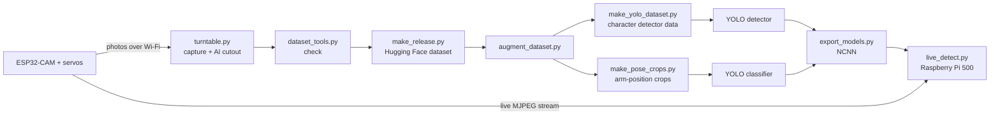

# HeroNet

**Spot the hero. Read the pose. Live.**

A low-cost rig that photographs Playmobil figures from every angle, turns the photos into a
labelled dataset, and trains two YOLO models that recognise **which character** is in front
of the camera and **what its arms are doing**, live, on a Raspberry Pi.

- **Camera:** ESP32-CAM (AI-Thinker, OV2640) streaming over Wi-Fi
- **Motion:** three SG90 servos (turntable, camera tilt, camera pan)
- **Dataset:** 792 transparent cutouts, 11 DC characters × 9 arm positions × 8 viewing angles,
  published on Hugging Face: [nicolashr/playmobil-dc-poses](https://huggingface.co/datasets/nicolashr/playmobil-dc-poses)
- **Models:** YOLO11n detector (character) + YOLO11n classifier (arm position), exported to
  NCNN for a Raspberry Pi 500, published on Hugging Face:
  [nicolashr/heronet](https://huggingface.co/nicolashr/heronet)
- **v2:** several figures in the same frame, including the same character twice

> **Why this exists:** I built this for my 8-year-old nephew, who loves Playmobil and superheroes.
> It's a hobby project, made for fun and learning rather than as a polished product, so expect
> some rough edges.



---

## Contents

1. [Hardware](#1-hardware)
2. [Firmware (ESP32-CAM)](#2-firmware-esp32-cam)
3. [Software setup](#3-software-setup)
4. [Capturing the photos](#4-capturing-the-photos)
5. [Checking and labelling the dataset](#5-checking-and-labelling-the-dataset)
6. [Publishing the dataset on Hugging Face](#6-publishing-the-dataset-on-hugging-face)
7. [Training the models](#7-training-the-models)
8. [Testing live](#8-testing-live)
9. [Running on the Raspberry Pi 500](#9-running-on-the-raspberry-pi-500)
10. [Script reference](#10-script-reference)
11. [Troubleshooting](#11-troubleshooting)

---

## 1. Hardware

| Part | Notes |
|---|---|
| ESP32-CAM, AI-Thinker (OV2640) | Needs PSRAM, which the AI-Thinker board has |
| USB-serial adapter (FTDI, 5 V) | Only for uploading the firmware |
| 3 × SG90 servos | Turntable, camera tilt, camera pan |
| 5 V power supply, ≥ 2 A | For the servos; three SG90s can draw over 1 A together |
| Pan-tilt bracket for SG90 | Pan servo at the bottom, tilt servo on top, camera on the tilt servo |
| Turntable | A disc on the turn servo's horn |
| White background | Behind the figure |
| A computer for training | A Mac with Apple Silicon was used (`device=mps`) |
| Raspberry Pi 500 (or Pi 5) | Runs the trained models live |

### Wiring

| ESP32-CAM pin | Connects to |
|---|---|
| IO14 | Turntable servo signal |
| IO15 | Tilt servo signal |
| IO13 | Pan servo signal |
| GND | Ground of the 5 V servo supply (**shared ground is essential**) |
| 5V / GND | Board power (from the USB-serial adapter or a 5 V supply) |

Servo red/brown wires go to the external 5 V supply, not to the ESP32-CAM. IO13, IO14 and IO15
are free because no SD card is used. The white flash LED (IO4) is kept off by the firmware.

**For uploading only:** adapter TX → U0R, adapter RX → U0T, adapter GND → GND, adapter 5V → 5V,
and **IO0 → GND** while uploading.

---

## 2. Firmware (ESP32-CAM)

Sketch: [`firmware/esp32cam_turntable/esp32cam_turntable.ino`](firmware/esp32cam_turntable/esp32cam_turntable.ino)

1. Arduino IDE → install the **esp32** board package (Espressif, version 3.x).
2. Open the sketch and set your Wi-Fi name and password (`WIFI_SSID`, `WIFI_PASS`).
3. Tools → Board → **AI Thinker ESP32-CAM**.
4. Connect **IO0 to GND**, press reset, click Upload.
5. Remove the IO0–GND wire, press reset.
6. Serial Monitor at **115200** shows the board's address, e.g. `Open http://192.168.0.10/`.

### Endpoints

| Address | What it does |
|---|---|
| `http://<ip>/` | Test page: live view, take a photo, buttons for all three servos |
| `http://<ip>/capture` | One full-resolution photo (1600×1200 JPEG) |
| `http://<ip>/angle?deg=90` | Turntable servo to 90° (0–180) |
| `http://<ip>/angle?deg=90&servo=tilt` | Tilt servo to 90° |
| `http://<ip>/angle?deg=90&servo=pan` | Pan servo to 90° |
| `http://<ip>/angle?by=-10&servo=pan` | Move a servo 10° from its current position |
| `http://<ip>/pulse?us=1500&servo=pan` | Raw pulse for 2 s, to find a servo's real 0° and 180° |
| `http://<ip>:81/stream?size=qvga` | Live MJPEG video (`qqvga`, `qvga`, `hvga`, `vga`, `svga`; optional `&q=12`) |

The stream runs on its own port (81), so servos can move while it is open. Only **one stream
at a time** is served: close a browser tab with the stream before running the scripts.
`/capture` waits for an open stream to close.

---

## 3. Software setup

On the training computer (Python 3.9+):

```bash
pip3 install -r requirements.txt
```

All Python scripts live in [`scripts/`](scripts/) and must stay in **one folder** (several import
`train_effects.py`, `augment_dataset.py` or `live_detect.py`). Run the commands below from that
folder, or copy the scripts next to your data.

---

## 4. Capturing the photos

Each character and arm position gets its own folder:

```
esp32/<character>/<arm_position>/angle_045_tilt_00_nobg.png
```

Put the figure on the turntable in the arm position, then:

```bash
python3 turntable.py 192.168.0.10 --tilts 0 --ai --out esp32/batman/both_up
```

- Takes 8 angles (0°, 45° … 315°). An SG90 only turns 180°, so after 135° the script asks you
  once to turn the figure 180° by hand (or use 2:1 gears with `--gear-ratio 2`).
- `--ai` removes the background with [rembg](https://github.com/danielgatis/rembg) (u2net) and saves
  only the transparent cutout (`pip3 install "rembg[cpu]"`).
- `--angle-step 22.5` and `--tilts -10,0,10` capture more views for a larger dataset.
- `--dry-run` moves through the angles without photos; the script resumes if interrupted.

---

## 5. Checking and labelling the dataset

### Check completeness

```bash
python3 dataset_tools.py esp32
```

Reports missing photos, unexpected files and cutouts touching the photo edge (e.g. the turntable
left in), writes `esp32/labels.csv` and one contact sheet per character in `esp32/_contact_sheets/`.
Look at the contact sheets: a photo in the wrong pose folder is the one mistake no script can find.

### Arm-position labels

Arm positions follow one rule, **which arm(s) + what they do**, with `left`/`right` being the
**figure's own** arms. [`poses.csv`](poses.csv) defines them, plus a per-arm label:

| arm position | left arm | right arm | description |
|---|---|---|---|
| `both_down` | down | down | both arms down |
| `both_side` | side | side | both arms straight out to the sides |
| `both_up` | up | up | both arms straight up |
| `left_side` | side | down | left arm out to the side, right arm down |
| `right_side` | down | side | right arm out to the side, left arm down |
| `left_up` | up | down | left arm straight up, right arm down |
| `right_up` | down | up | right arm straight up, left arm down |
| `left_high` | diagonal_up | diagonal_down | arms tilted, left arm higher |
| `right_high` | diagonal_down | diagonal_up | arms tilted, right arm higher |

To rename existing folders from a table (`folder` = current name, `name` = new name):

```bash
python3 make_release.py esp32 --make-poses-template poses.csv   # template from your folders
python3 rename_poses.py esp32 poses.csv            # preview
python3 rename_poses.py esp32 poses.csv --apply    # rename in every character
```

Characters: `aquaman`, `batman`, `blackadam`, `catwoman`, `cyborg`, `harleyquinn`, `joker`,
`riddler`, `robin`, `supergirl`, `wonderwoman`.

---

## 6. Publishing the dataset on Hugging Face

```bash
python3 make_release.py esp32 playmobil_release --cut-below 0.80 --poses poses.csv \
    --left-right figure --owners "DC Comics" \
    --title "Playmobil DC Figures: Arm Positions and Viewing Angles" \
    --repo-id nicolashr/playmobil-dc-poses
```

- Cleans the cutouts (haze, `--cut-below` removes the turntable base under the feet).
- Fixed random 80/20 split per character and arm position (`--seed 42`).
- Writes `data/{train,test}/…` with `metadata.jsonl` (labels, per-arm labels, boxes), COCO files,
  `labels.csv`, a preview, `README.md` (dataset card, CC BY 4.0) and copies of the scripts and
  firmware (Wi-Fi credentials replaced by placeholders).
- Fill in the viewing-angle convention in the generated `README.md`, then:

```bash
pip3 install -U huggingface_hub
hf auth login
hf upload nicolashr/playmobil-dc-poses playmobil_release . --repo-type dataset --private
```

Check the dataset page and viewer, then make it public in Settings. Anyone can get it with
`hf download nicolashr/playmobil-dc-poses --repo-type dataset --local-dir playmobil_release`.

---

## 7. Training the models

Two models run one after the other on every frame:

| Step | Model | Classes | Input |
|---|---|---|---|
| Find the figure, name the character | YOLO11n detector | 11 characters | 320 px |
| Name the arm position on the crop | YOLO11n classifier | 9 arm positions | 224 px |

The arm-position model learns from **all characters together** (88 real photos per class), so
it can also work on figures it has never seen.

### 7.1 Photograph the empty scene

With the camera in its final position, white background, no figure:

```bash
python3 grab_frames.py 192.168.0.10 empty_scene --count 30 --interval 1
```

While it runs, change the pan angle on the test page and vary the light a little. These
frames become the training backgrounds and "no figure here" examples.

### 7.2 Augment

```bash
python3 augment_dataset.py playmobil_release/data aug_live
```

10 variants per photo (scale, position, rotation, perspective, colour, blur, noise, JPEG) plus
**label-correct mirroring**: a mirrored `left_up` becomes `right_up` and the angle becomes
360° − angle. Uses the dataset's own train/test split.

### 7.3 Build the two training sets

```bash
python3 make_yolo_dataset.py aug_live yolo_char_live --classes character \
    --random-bg --backgrounds empty_scene --white-fraction 0.1 --low-res --negatives empty_scene

python3 make_pose_crops.py aug_live pose_crops_live \
    --random-bg --backgrounds empty_scene --white-fraction 0.1 --low-res
```

- `--random-bg --backgrounds empty_scene`: figures pasted on your real camera scene.
- `--low-res`: images degraded like 320×240 stream frames (shrink, enlarge, JPEG).
- `--negatives`: empty-scene frames with no boxes.
- Boxes come from the cutouts' transparency, so no manual annotation is needed.

Check `yolo_char_live/preview_boxes.jpg` and `pose_crops_live/preview_crops.jpg`.

### 7.4 Train

```bash
yolo detect train data=yolo_char_live/data.yaml model=yolo11n.pt imgsz=320 epochs=60 device=mps project=runs name=character_live
yolo classify train data=pose_crops_live model=yolo11n-cls.pt imgsz=224 epochs=50 fliplr=0 device=mps project=runs name=pose_live
```

`fliplr=0` is essential for the classifier: YOLO's own flipping would keep the label and mix up
left and right (the mirroring is already done, correctly, by `augment_dataset.py`).
Use `device=cpu` without Apple Silicon, or `device=0` with an NVIDIA GPU.

Find the trained weights with `find runs -name best.pt` and copy them, e.g. to
`models/character.pt` and `models/pose.pt`.

### 7.5 HeroNet v2: several figures at once

The same photos can teach the models to handle groups. Because the cutouts are transparent,
`make_yolo_dataset.py --multi` **composes scenes** with 2–4 figures on your empty-scene frames:
different sizes and positions, sometimes overlapping, sometimes the same character twice (from
different photos). Each box covers only the visible part of its figure, and every figure keeps at
least 40% visible. Training scenes use only training photos; validation scenes only test photos.

```bash
python3 make_yolo_dataset.py aug_live yolo_char_multi --classes character \
    --random-bg --backgrounds empty_scene --white-fraction 0.1 --low-res --negatives empty_scene \
    --multi 4000

python3 make_pose_crops.py aug_live pose_crops_multi \
    --random-bg --backgrounds empty_scene --white-fraction 0.1 --low-res --neighbours 0.4

yolo detect train data=yolo_char_multi/data.yaml model=yolo11n.pt imgsz=320 epochs=60 device=mps project=runs name=character_multi
yolo classify train data=pose_crops_multi model=yolo11n-cls.pt imgsz=224 epochs=50 fliplr=0 device=mps project=runs name=pose_multi
```

- `--multi 4000` adds 4000 group scenes to the single-figure images (`--max-per-scene`,
  `--repeat-prob`, `--min-visible` tune them). Check `preview_boxes.jpg`: half of it shows scenes.
- `--neighbours 0.4`: 40% of the arm-position crops show another figure partly in view, as happens
  live when figures stand side by side.
- When the figures stand on the white background (the turntable fits only one), grab a few
  empty-scene frames of that area too.
- With several figures each one is smaller in the frame: if arm positions suffer, use
  `--size vga` live.

---

## 8. Testing live

```bash
python3 live_detect.py 192.168.0.10 --det models/character.pt --pose models/pose.pt
```

Shows the stream with a box per figure (up to 3, `--max-figures`), its character and arm position,
plus the time per model and the frame rate. Keys: `q` quit, `space` pause, `s` save. Options:
`--size vga`, `--rotate 90`, `--serve 8000` (watch in a browser), `--image file.png` (one image).

### Measure accuracy on real frames

Grab about 2 frames per character and arm position:

```bash
python3 grab_frames.py 192.168.0.10 live_test/batman/both_up --count 2 --enter
```

Then:

```bash
python3 evaluate_live.py live_test --det models/character.pt --pose models/pose.pt
```

Reports character, arm-position and combined accuracy, per-class results, the most common
mistakes (saved as annotated images) and the speed.

For groups (v2), name each folder after the figures in the frame:

```bash
python3 grab_frames.py 192.168.0.10 live_test_multi/batman+joker --count 3 --enter
python3 grab_frames.py 192.168.0.10 live_test_multi/batman+batman+robin --count 3 --enter
python3 evaluate_live.py live_test_multi --multi --det models/character_multi.pt --pose models/pose_multi.pt
```

Reports how many frames got exactly the right characters, figure-level recall and precision,
frames with too few or too many boxes, and the most common mistakes.

---

## 9. Running on the Raspberry Pi 500

### Export (on the training computer)

```bash
pip3 install ncnn pnnx
python3 export_models.py --det models/character.pt --pose models/pose.pt --check live_test --out pi_models
```

NCNN is the fastest format on the Pi's CPU. The script checks that the exported models give the
same answers as the originals.

### Set up the Pi

```bash
sudo apt update && sudo apt install -y python3-venv
python3 -m venv ~/yolo && source ~/yolo/bin/activate
pip install ultralytics ncnn
mkdir -p ~/turntable
```

From the training computer:

```bash
scp -r pi_models scripts/live_detect.py scripts/train_effects.py scripts/evaluate_live.py \
    scripts/grab_frames.py <user>@<pi-ip>:~/turntable/
```

### Run

```bash
cd ~/turntable && source ~/yolo/bin/activate
python3 live_detect.py 192.168.0.10 --det pi_models/det_ncnn_model --pose pi_models/pose_ncnn_model --serve 8000
```

The window opens on the Pi's screen; `http://<pi-ip>:8000` shows the same in any browser. Without
a screen (SSH) the script runs headless automatically. Expected speed on the Pi 5 CPU with NCNN is
roughly 12–20 fps at 320×240; the bottom line of the window shows the real numbers.

---

## 10. Script reference

| Script | Purpose |
|---|---|
| `turntable.py` | Capture photos at every angle/tilt, optional AI background removal |
| `dataset_tools.py` | Check completeness, write `labels.csv`, contact sheets |
| `rename_poses.py` | Rename arm-position folders in every character from `poses.csv` |
| `make_release.py` | Build the Hugging Face dataset (cleaning, split, metadata, COCO, card) |
| `augment_dataset.py` | Offline augmentation with label-correct mirroring |
| `train_effects.py` | Shared helpers: backgrounds, low-res simulation, crop box |
| `make_yolo_dataset.py` | YOLO detection dataset (boxes from transparency, negatives) |
| `make_pose_crops.py` | Cropped arm-position classification dataset |
| `grab_frames.py` | Save raw frames from the live stream |
| `live_detect.py` | Live detector + classifier on the stream, window and browser view |
| `evaluate_live.py` | Accuracy on real labelled frames |
| `export_models.py` | NCNN export for the Raspberry Pi with an agreement check |

Every script has `--help`.

---

## 11. Troubleshooting

| Problem | Fix |
|---|---|
| Upload fails / "Failed to connect to ESP32" | IO0 must be connected to GND during upload; press reset first |
| Board restarts, "Brownout detector was triggered" | Stronger 5 V supply; servos on their own supply |
| Servos don't move | Shared ground between servo supply and ESP32-CAM; check the signal pin |
| Script hangs on the stream | Another stream (e.g. a browser tab) is open; only one at a time |
| `/capture` returns 409 | A stream is still open; close it |
| `unrecognized arguments` | An older copy of the script; use the versions in `scripts/` |
| `No photos found` with the release folder | Point at `playmobil_release/data` and use the current `augment_dataset.py` |
| `zsh: no matches found` | zsh refuses globs that match nothing; use `find runs -name best.pt` |
| Trained models not in `runs/` | They are saved relative to the folder `yolo` was run from |
| Left/right arm positions confused | Classifier trained without `fliplr=0` |
| Two figures get one box, or extra boxes appear | Train the v2 detector (`--multi`); try `--size vga` |
| Figure touches the photo edge | Turntable base in the cutout: `--cut-below 0.80` |

---

## Licence

Code: MIT (see [`LICENSE`](LICENSE)). Dataset: CC BY 4.0, on Hugging Face. Trained models:
AGPL-3.0, as they are trained from Ultralytics YOLO11 (AGPL-3.0).
Playmobil is a trademark of geobra Brandstätter Stiftung & Co. KG; the characters are trademarks
of DC Comics. This project is not affiliated with or endorsed by either.
